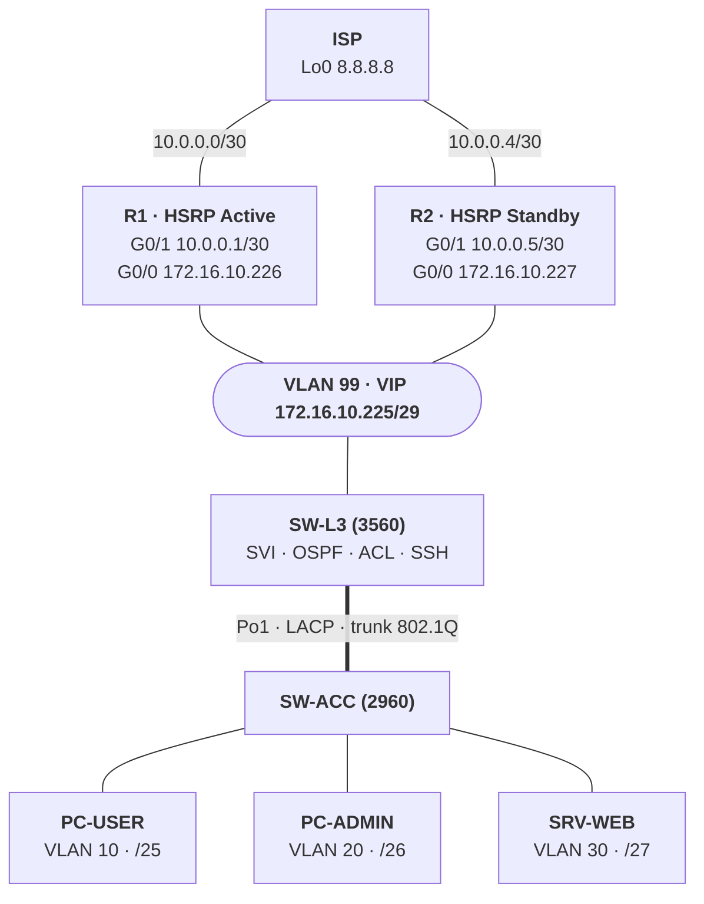

# 🌐 Réseau d'entreprise redondant sous Cisco Packet Tracer

Conception et configuration d'une infrastructure réseau d'entreprise **hautement disponible** : segmentation en VLAN, agrégation de liens **LACP**, routage inter-VLAN sur switch de niveau 3, passerelle redondante **HSRP**, routage dynamique **OSPF**, filtrage par **ACL** et administration sécurisée en **SSH**.

> Projet de travaux pratiques réalisé dans le cadre de ma formation Systèmes, Réseaux & Cybersécurité (IEF2I).

---

## 📑 Sommaire

1. [Objectifs](#-objectifs)
2. [Topologie](#-topologie)
3. [Plan d'adressage](#-plan-dadressage)
4. [Technologies mises en œuvre](#-technologies-mises-en-œuvre)
5. [Contenu du dépôt](#-contenu-du-dépôt)
6. [Configurations](#-configurations)
7. [Vérifications et résultats attendus](#-vérifications-et-résultats-attendus)
8. [Tests de validation](#-tests-de-validation)
9. [Compétences démontrées](#-compétences-démontrées)
10. [Pistes d'amélioration](#-pistes-damélioration)
11. [Auteur](#-auteur)

---

## 🎯 Objectifs

- Segmenter le réseau en **4 VLAN** (utilisateurs, administration, serveurs, transit).
- Agréger deux liens entre switchs avec **LACP** et les faire fonctionner en **trunk 802.1Q**.
- Router entre les VLAN avec un **switch L3** (SVI).
- Assurer la **haute disponibilité** de la passerelle avec **HSRP** (R1 actif / R2 en secours), avec `preempt` et suivi du lien vers l'ISP.
- Diffuser les routes internes avec **OSPF** et joindre un « Internet » simulé par des routes statiques, dont une **route flottante** de secours.
- Appliquer une politique de sécurité : **ACL étendues** et accès **SSH** limité au VLAN d'administration.

---

## 🗺️ Topologie



### Câblage

| # | De | Vers | Câble |
|---|----|------|-------|
| 1 | ISP Gi0/0 | R1 Gi0/1 | Croisé |
| 2 | ISP Gi0/1 | R2 Gi0/1 | Croisé |
| 3 | SW-L3 Fa0/23 | SW-ACC Fa0/23 | Croisé |
| 4 | SW-L3 Fa0/24 | SW-ACC Fa0/24 | Croisé |
| 5 | R1 Gi0/0 | SW-L3 Fa0/1 | Droit |
| 6 | R2 Gi0/0 | SW-L3 Fa0/2 | Droit |
| 7 | SW-ACC Fa0/1 | PC-USER | Droit |
| 8 | SW-ACC Fa0/2 | PC-ADMIN | Droit |
| 9 | SW-ACC Fa0/3 | SRV-WEB | Droit |

### Matériel simulé

| Rôle | Équipement | Modèle Packet Tracer |
|------|------------|----------------------|
| Internet simulé | ISP | Routeur 2911 |
| Routeur HSRP actif / secours | R1 / R2 | Routeur 2911 |
| Cœur de réseau (niveau 3) | SW-L3 | Switch 3560-24PS |
| Accès (niveau 2) | SW-ACC | Switch 2960-24TT |
| Postes et serveur | PC-USER, PC-ADMIN, SRV-WEB | PC et Server |

---

## 🔢 Plan d'adressage

### Réseaux

| Réseau | Sous-réseau | Passerelle / adresses |
|--------|-------------|------------------------|
| VLAN 10 – USERS | `172.16.10.0/25` | SVI SW-L3 : `172.16.10.1` |
| VLAN 20 – ADMIN | `172.16.10.128/26` | SVI : `172.16.10.129` |
| VLAN 30 – SERVEURS | `172.16.10.192/27` | SVI : `172.16.10.193` |
| VLAN 99 – TRANSIT | `172.16.10.224/29` | VIP HSRP `.225` · R1 `.226` · R2 `.227` · SW-L3 `.228` |
| ISP ↔ R1 | `10.0.0.0/30` | R1 `10.0.0.1` · ISP `10.0.0.2` |
| ISP ↔ R2 | `10.0.0.4/30` | R2 `10.0.0.5` · ISP `10.0.0.6` |
| Loopback ISP | `8.8.8.8/32` | Simule un serveur sur Internet |

### Machines

| Machine | Adresse IP | Masque | Passerelle | VLAN |
|---------|-----------|--------|------------|------|
| PC-USER | 172.16.10.10 | 255.255.255.128 | 172.16.10.1 | 10 |
| PC-ADMIN | 172.16.10.130 | 255.255.255.192 | 172.16.10.129 | 20 |
| SRV-WEB | 172.16.10.194 | 255.255.255.224 | 172.16.10.193 | 30 |

---

## 🛠️ Technologies mises en œuvre

| Technologie | Mise en œuvre |
|-------------|----------------|
| **VLAN** | Segmentation 10 / 20 / 30 / 99 |
| **Trunk 802.1Q + LACP** | `Po1` : deux liens agrégés entre SW-L3 et SW-ACC |
| **RSTP** | `spanning-tree mode rapid-pvst` pour une convergence rapide |
| **SVI** | Routage inter-VLAN sur le switch de niveau 3 |
| **HSRP v2** | R1 Active (priorité 110) / R2 Standby (100), `preempt`, `track` du lien ISP |
| **OSPF** | Annonce des réseaux internes (aire 0), interfaces utilisateurs en passif |
| **Routes statiques** | Route par défaut vers la VIP, retours côté ISP, **route flottante** (AD 10) |
| **ACL** | ACL étendues sur les VLAN 10 et 30, ACL standard pour l'accès SSH |
| **SSH v2** | Administration chiffrée de SW-L3, limitée au VLAN ADMIN |

---

## 📁 Contenu du dépôt

```text
.
├── README.md
├── lab/
│   └── Lab-HSRP-LACP.pkt                    # Fichier Packet Tracer
└── docs/
    └── Compte-rendu-Lab-HSRP-LACP.docx      # Compte rendu détaillé (commandes + résultats attendus)
```

> Le fichier `.pkt` s'ouvre avec **Cisco Packet Tracer**.

---

## ⚙️ Configurations

Les mots de passe sont remplacés par des valeurs à définir (`<MOT_DE_PASSE_…>`).

<details>
<summary><b>SW-L3 (3560) : VLAN, trunk LACP, SVI, OSPF, ACL, SSH</b></summary>

```text
enable
configure terminal
hostname SW-L3
no ip domain-lookup
spanning-tree mode rapid-pvst
ip routing

vlan 10
 name USERS
vlan 20
 name ADMIN
vlan 30
 name SERVEURS
vlan 99
 name TRANSIT
exit

! Ports vers R1 et R2 (VLAN 99)
interface range fastEthernet 0/1 - 2
 switchport mode access
 switchport access vlan 99
 spanning-tree portfast
 no shutdown
exit

! Trunk LACP vers SW-ACC
interface range fastEthernet 0/23 - 24
 channel-group 1 mode active
exit
interface port-channel 1
 switchport trunk encapsulation dot1q
 switchport mode trunk
 switchport trunk allowed vlan 10,20,30
exit

! SVI (passerelles des VLAN)
interface vlan 10
 ip address 172.16.10.1 255.255.255.128
 no shutdown
interface vlan 20
 ip address 172.16.10.129 255.255.255.192
 no shutdown
interface vlan 30
 ip address 172.16.10.193 255.255.255.224
 no shutdown
interface vlan 99
 ip address 172.16.10.228 255.255.255.248
 no shutdown
exit

! Routage
ip route 0.0.0.0 0.0.0.0 172.16.10.225
router ospf 1
 router-id 3.3.3.3
 network 172.16.10.0 0.0.0.127 area 0
 network 172.16.10.128 0.0.0.63 area 0
 network 172.16.10.192 0.0.0.31 area 0
 network 172.16.10.224 0.0.0.7 area 0
 passive-interface vlan 10
 passive-interface vlan 20
 passive-interface vlan 30
exit

! ACL de filtrage
ip access-list extended USERS-IN
 permit tcp 172.16.10.0 0.0.0.127 host 172.16.10.194 eq 80
 permit tcp 172.16.10.0 0.0.0.127 host 172.16.10.194 eq 443
 deny ip 172.16.10.0 0.0.0.127 172.16.10.128 0.0.0.63
 deny ip 172.16.10.0 0.0.0.127 172.16.10.192 0.0.0.31
 deny ip 172.16.10.0 0.0.0.127 172.16.10.224 0.0.0.7
 permit ip any any
exit
ip access-list extended SERVEURS-IN
 permit tcp 172.16.10.192 0.0.0.31 any established
 permit icmp 172.16.10.192 0.0.0.31 any echo-reply
 deny ip 172.16.10.192 0.0.0.31 172.16.10.0 0.0.0.255
 permit ip any any
exit
interface vlan 10
 ip access-group USERS-IN in
interface vlan 30
 ip access-group SERVEURS-IN in
exit

! SSH
ip domain-name lab.local
crypto key generate rsa modulus 2048
ip ssh version 2
username admin secret <MOT_DE_PASSE_ADMIN>
enable secret <MOT_DE_PASSE_ENABLE>
service password-encryption
ip access-list standard SSH-ADMIN
 permit 172.16.10.128 0.0.0.63
exit
line vty 0 15
 transport input ssh
 login local
 access-class SSH-ADMIN in
 exec-timeout 5 0
end
copy running-config startup-config
```

</details>

<details>
<summary><b>SW-ACC (2960) : VLAN, trunk LACP, ports d'accès</b></summary>

```text
enable
configure terminal
hostname SW-ACC
no ip domain-lookup
spanning-tree mode rapid-pvst

vlan 10
 name USERS
vlan 20
 name ADMIN
vlan 30
 name SERVEURS
exit

interface range fastEthernet 0/23 - 24
 channel-group 1 mode active
exit
interface port-channel 1
 switchport mode trunk
 switchport trunk allowed vlan 10,20,30
exit

interface fastEthernet 0/1
 switchport mode access
 switchport access vlan 10
 spanning-tree portfast
interface fastEthernet 0/2
 switchport mode access
 switchport access vlan 20
 spanning-tree portfast
interface fastEthernet 0/3
 switchport mode access
 switchport access vlan 30
 spanning-tree portfast
end
copy running-config startup-config
```

</details>

<details>
<summary><b>R1 (HSRP Active)</b></summary>

```text
enable
configure terminal
hostname R1
no ip domain-lookup

interface gigabitEthernet 0/1
 description Vers ISP
 ip address 10.0.0.1 255.255.255.252
 no shutdown
exit

interface gigabitEthernet 0/0
 description Vers SW-L3 VLAN 99
 ip address 172.16.10.226 255.255.255.248
 standby version 2
 standby 99 ip 172.16.10.225
 standby 99 priority 110
 standby 99 preempt
 standby 99 track gigabitEthernet 0/1 20
 no shutdown
exit

router ospf 1
 router-id 1.1.1.1
 network 172.16.10.224 0.0.0.7 area 0
exit
ip route 0.0.0.0 0.0.0.0 10.0.0.2
end
copy running-config startup-config
```

</details>

<details>
<summary><b>R2 (HSRP Standby)</b></summary>

```text
enable
configure terminal
hostname R2
no ip domain-lookup

interface gigabitEthernet 0/1
 description Vers ISP
 ip address 10.0.0.5 255.255.255.252
 no shutdown
exit

interface gigabitEthernet 0/0
 description Vers SW-L3 VLAN 99
 ip address 172.16.10.227 255.255.255.248
 standby version 2
 standby 99 ip 172.16.10.225
 standby 99 priority 100
 standby 99 preempt
 no shutdown
exit

router ospf 1
 router-id 2.2.2.2
 network 172.16.10.224 0.0.0.7 area 0
exit
ip route 0.0.0.0 0.0.0.0 10.0.0.6
end
copy running-config startup-config
```

</details>

<details>
<summary><b>ISP (Internet simulé)</b></summary>

```text
enable
configure terminal
hostname ISP
no ip domain-lookup

interface loopback 0
 ip address 8.8.8.8 255.255.255.255
exit

interface gigabitEthernet 0/0
 description Vers R1
 ip address 10.0.0.2 255.255.255.252
 no shutdown
exit
interface gigabitEthernet 0/1
 description Vers R2
 ip address 10.0.0.6 255.255.255.252
 no shutdown
exit

! Routes de retour : route principale via R1, route flottante (AD 10) via R2
ip route 172.16.10.0 255.255.255.0 10.0.0.1
ip route 172.16.10.0 255.255.255.0 10.0.0.5 10
end
copy running-config startup-config
```

</details>

---

## ✅ Vérifications et résultats attendus

| Fonction | Commande | Résultat attendu |
|----------|----------|------------------|
| VLAN | `show vlan brief` | VLAN 99 sur SW-L3 (Fa0/1, Fa0/2) ; VLAN 10, 20, 30 sur SW-ACC |
| LACP | `show etherchannel summary` | `Po1(SU)` avec `Fa0/23(P)` et `Fa0/24(P)` |
| Trunk | `show interfaces trunk` | `Po1` en 802.1q, `trunking`, VLAN 10,20,30 |
| HSRP | `show standby brief` | R1 `Active` (110), R2 `Standby` (100), VIP `172.16.10.225` |
| SVI | `show ip interface brief` | Vlan 10, 20, 30, 99 en `up/up` |
| OSPF | `show ip ospf neighbor` | R1 et R2 en `FULL` ou `2WAY` selon l'élection DR/BDR |
| Routage | `show ip route` (SW-L3) | Réseaux connectés `C` et route par défaut `S*` via `172.16.10.225` |

Exemple de résultat attendu pour HSRP :

```text
R1# show standby brief
Interface  Grp  Pri  P  State    Active          Standby         Virtual IP
Gi0/0      99   110  P  Active   local           172.16.10.227   172.16.10.225

R2# show standby brief
Interface  Grp  Pri  P  State    Active          Standby         Virtual IP
Gi0/0      99   100  P  Standby  172.16.10.226   local           172.16.10.225
```

---

## 🧪 Tests de validation

| Depuis | Test | Résultat attendu |
|--------|------|------------------|
| PC-USER | `ping 172.16.10.1` | Succès (passerelle du VLAN 10) |
| PC-USER | `ping 172.16.10.130` (PC-ADMIN) | **Échec** (bloqué par l'ACL) |
| PC-USER | Navigateur : `http://172.16.10.194` | Succès (HTTP autorisé vers SRV-WEB) |
| PC-USER | `ping 8.8.8.8` | Succès (accès Internet simulé) |
| PC-USER | `ssh -l admin 172.16.10.1` | **Refus** (SSH réservé au VLAN ADMIN) |
| PC-ADMIN | `ping 172.16.10.10` / `.194` | Succès |
| PC-ADMIN | `ssh -l admin 172.16.10.129` | Succès, invite `SW-L3#` |

### Test de bascule HSRP

1. Lancer `ping 8.8.8.8 -t` depuis PC-USER.
2. Sur R1 : `interface gigabitEthernet 0/1` puis `shutdown`.
3. **Résultat attendu** : la priorité de R1 passe à 90, R2 devient `Active`, quelques paquets sont perdus puis la connectivité revient.
4. Faire `no shutdown` sur R1 : grâce à `preempt`, R1 reprend le rôle `Active`.

---

## 🧠 Compétences démontrées

- Conception d'un plan d'adressage IPv4 avec découpage en sous-réseaux (VLSM)
- Configuration de switchs Cisco (VLAN, trunk 802.1Q, EtherChannel LACP, RSTP)
- Routage inter-VLAN sur switch de niveau 3 et routage dynamique OSPF
- Haute disponibilité de la passerelle (HSRP) et routes de secours
- Filtrage du trafic par ACL et durcissement de l'administration (SSH v2, `access-class`)
- Méthodologie de test, de validation et de documentation technique

---

## 🚀 Pistes d'amélioration

- Changer le VLAN natif du trunk (différent de 1)
- Ajouter du **NAT** sur R1 et R2 pour simuler un accès Internet réaliste
- Doubler le switch d'accès pour supprimer le point unique de défaillance
- Activer l'authentification OSPF et la sécurité des ports (`port-security`) sur SW-ACC

---

## 👤 Auteur

**Audrey Loïc NGOMPA YOMBO**
Étudiant en Mastère 1 Systèmes, Réseaux & Cybersécurité (IEF2I), à la recherche d'une alternance en administration systèmes et réseaux.

- GitHub : [Lordemilio237](https://github.com/Lordemilio237)
- LinkedIn : [linkedin.com/in/loïc-ngompa](https://www.linkedin.com/in/loïc-ngompa)
